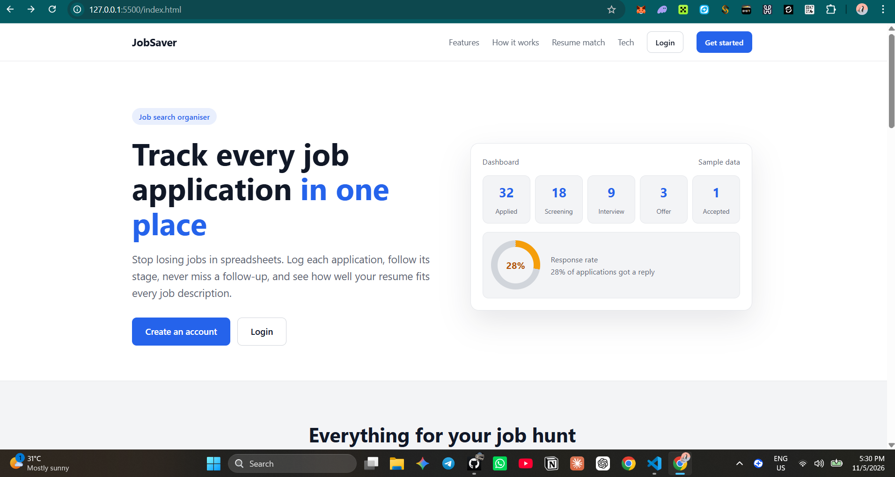
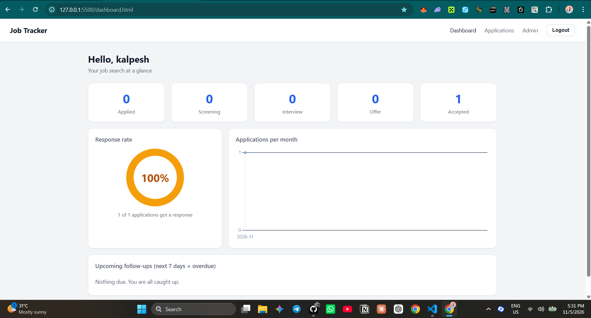
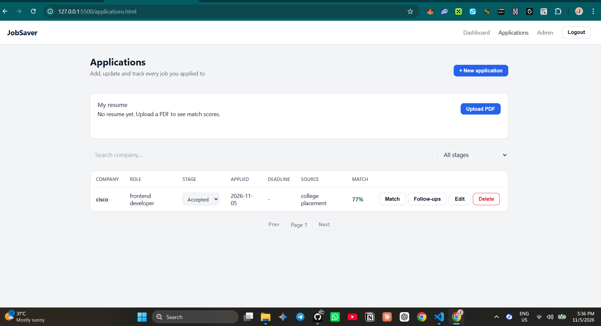
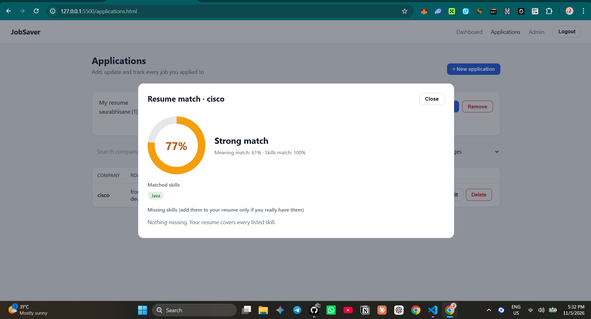

# JobSaver

> Job Application Tracking System: follow-ups, analytics, and a resume-to-job match score.

JobSaver is a full-stack portfolio project. It helps a job seeker stop losing applications in spreadsheets, remember follow-ups, and see how well a resume fits each job description.


## Screenshots

| Landing page | Dashboard |
|---|---|
|  |  |

| Applications | Resume match |
|---|---|
|  |  |

## Features

- **Pipeline tracking:** Applied, Screening, Interview, Offer, Accepted, Rejected. Search by company, filter by stage, paginated list.
- **Follow-ups:** attach dated follow-ups to any application; upcoming and overdue items show on the dashboard.
- **Analytics dashboard:** applications per stage, response rate, applications per month (database aggregation, Chart.js).
- **Resume match score:** upload a PDF resume, compare it with a job description, get a score plus matched and missing skills. Runs locally with an ONNX embedding model, so no paid AI API is needed.
- **Authentication:** email login with JWT access and refresh tokens, silent token refresh in the frontend.
- **Admin panel:** platform stats, user list with search and filter, activate or deactivate users, delete users, view a user's applications (summary only, never private notes).
- **Landing page** for visitors before sign-up.

## Tech stack

| Layer | Technology |
|---|---|
| Frontend | HTML, CSS, JavaScript, Chart.js |
| Backend | Python, Django, Django REST Framework |
| Auth | JWT (SimpleJWT), custom email-based user model |
| Database | MySQL |
| Resume match | fastembed (ONNX Runtime, model `all-MiniLM-L6-v2`), pdfplumber, skill-list keyword check |

### How the resume match score works

1. Skills are found in the job description and in the resume with a curated skill list (about 90 skills with aliases).
2. Both texts are split into chunks and turned into embeddings. For each job-description chunk, the best matching resume chunk is found, and the similarities are averaged (the "meaning" score).
3. Final score = 60% meaning score + 40% skill coverage. Missing keywords are the job's skills that the resume does not mention.

## API overview

All endpoints are under `/api/`. Everything except register, login and refresh needs the header `Authorization: Bearer <access token>`.

| Area | Endpoints |
|---|---|
| Auth | `POST auth/register/` · `POST auth/login/` · `POST auth/refresh/` · `GET auth/me/` |
| Resume | `GET/POST/DELETE resume/` |
| Applications | `GET/POST applications/` · `GET/PUT/PATCH/DELETE applications/{id}/` · `PATCH applications/{id}/status/` · `POST applications/{id}/match/` |
| Follow-ups | `GET/POST applications/{id}/followups/` · `PUT/PATCH/DELETE followups/{id}/` · `GET followups/upcoming/?days=7` |
| Dashboard | `GET dashboard/stats/` · `GET dashboard/response-rate/` · `GET dashboard/timeline/` |
| Admin (role `admin`) | `GET admin/stats/` · `GET admin/users/` · `PATCH admin/users/{id}/status/` · `DELETE admin/users/{id}/` · `GET admin/users/{id}/applications/` |

27 endpoints in total.

## Security and quality notes

- Passwords are hashed (Django PBKDF2). Secrets and database credentials come from environment variables, never from code.
- Every query is scoped to the logged-in user, so one user can never read another user's data (the API answers 404).
- Admin endpoints use a custom permission class and are checked on the server for every request.
- Access tokens expire after 60 minutes; refresh tokens after 7 days.
- Resume upload checks size (2 MB), real file signature, and page count. Only the extracted text is stored, not the PDF.
- Request throttling on upload and match endpoints. CORS allows only the configured frontend origin.
- Frontend renders all server data with `textContent`, never `innerHTML`.

## Run it locally

**Requirements:** Python 3.12 or newer, MySQL 8, Git.

```powershell
git clone https://github.com/kalpeshb2004/JobSaver.git
cd JobSaver\DjangoBackend

python -m venv venv
venv\Scripts\activate            # macOS/Linux: source venv/bin/activate
pip install -r requirements.txt

copy .env.example .env           # macOS/Linux: cp .env.example .env
# edit .env: set SECRET_KEY and your MySQL password
```

Create the database in MySQL:

```sql
CREATE DATABASE jobsaver CHARACTER SET utf8mb4 COLLATE utf8mb4_unicode_ci;
```

Then:

```powershell
python manage.py migrate
python manage.py createsuperuser     # this account is an admin
python manage.py runserver
```

In a second terminal, start the frontend:

```powershell
cd JobSaver\Frontend
python -m http.server 5500
```

Open <http://127.0.0.1:5500/>. The first resume match downloads a small embedding model (about 90 MB) once.

## Project structure

```
JobSaver/
├── DjangoBackend/
│   ├── config/          settings and root URLs
│   ├── accounts/        custom user (email login), JWT auth, resume upload
│   ├── applications/    applications, follow-ups, resume matching
│   ├── dashboard/       analytics endpoints
│   ├── adminpanel/      admin-only endpoints
│   └── manage.py
├── Frontend/            landing, login, register, dashboard, applications, admin
└── Backend/             first version in FastAPI (tag fastapi-v1), kept for reference
```

The backend was first written in FastAPI, then rebuilt with Django REST Framework to learn both. The API shape stayed the same.

Built by [@kalpeshb2004](https://github.com/kalpeshb2004).
